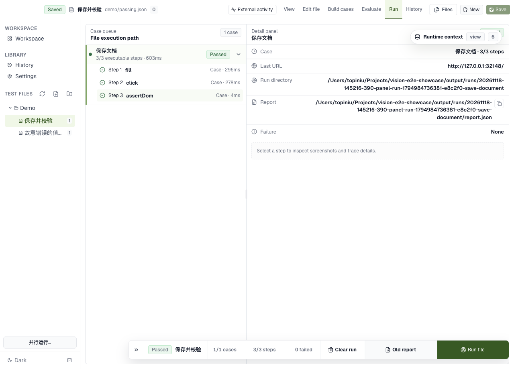
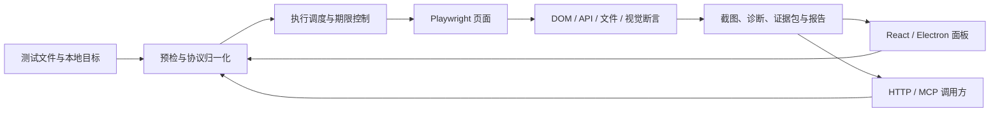

# Vision E2E

**一个可观察、可取消、可留下执行证据的浏览器 E2E 工作台。**

基于 v1.11 整理的求职展示版。保留 Electron + React 面板、Playwright 执行器、MCP 集成与报告链路；所有随仓库分发的场景使用合成数据。桌面应用使用独立的 userData 目录，默认服务仅监听本机。

## 先运行一次完整演示

需要 Node.js 22 或更新版本，以及 Playwright Chromium：

```bash
npm ci
npx playwright install chromium
npm run demo
```

演示会启动临时本地网页，执行两份真实工作流，随后关闭网页服务：

| 场景 | 执行与判定 |
| --- | --- |
| [`demo/passing.json`](test-workflows/demo/passing.json) | 输入文档名、保存、校验页面中的值，预期通过 |
| [`demo/failing.json`](test-workflows/demo/failing.json) | 同样执行保存，但声明一个故意错误的期望值，预期失败 |

脚本只有在两种判定都正确、证据包校验通过、真实截图已生成时才返回成功。它不把失败场景伪装为绿灯。

结果在 `output/demo/summary.json`；详细目录为 `output/sessions/<session-id>/rounds/round-1/`，包含 aggregate、diagnosis、repair context、Markdown 报告及证据包。`output/` 不进入 Git。

运行 `npm run demo:board`，打开 `http://127.0.0.1:32149/run-board` 可查看这些真实执行记录。



[运行看板截图](docs/demo/run-board.png) · [失败断言与截图证据](docs/demo/failed-run.png)

## 使用桌面工作台

```bash
# 终端一：启动本地被测网页，固定端口 32148
npm run demo:serve

# 终端二：启动面板、runtime 服务和 Electron
npm run dev
```

从文件列表选择 `Demo` 下的正例或反例，进入 Build cases 查看步骤，再点击 Run。反例出现红色结果是预期行为。关闭 `demo:serve` 时按 Ctrl+C。

首次启动桌面应用时，Electron 包可能需要下载当前平台的二进制；后续启动复用本地安装。

- `npm start`：构建面板后运行桌面应用。
- `npm run web`：只预览面板；浏览器模式不具备 Electron IPC 自动化能力。
- `npm run runtime:server`：独立 HTTP runtime，默认 `127.0.0.1:32146`。
- 桌面 App Run / MCP 服务默认 `127.0.0.1:32147`；开发时端口占用会自动顺延。
- `npm run release:dir`：在当前系统构建未安装目录。macOS / Windows 安装包需各自在对应系统构建。

## 核心设计与代码入口



| 工程问题 | 当前实现 | 入口 |
| --- | --- | --- |
| 桌面与无头执行容易分叉 | 同一执行器接受注入的 page，或创建独立 context | `runtime/executor/run-session.js` |
| 长任务占住调用连接 | 异步 session 句柄、进度事件、终态查询 | `runtime/server/test-session-runner.js` |
| 页面挂起造成无限等待 | 探测、步骤和会话分层期限，取消与进程隔离 | `runtime/executor/hard-timeout.js` |
| 操作执行了，但没有证明结果 | 显式值断言、页面错误门、文件断言、反例校准 | `runtime/assertions/`、`test/fixtures/selfcheck/` |
| 失败只能人工翻日志 | 聚合报告、诊断、repair context、证据包校验 | `runtime/reporting/` |
| 环境和账号被写入用例 | 运行目标参数与本地 credentialRef | `src/shared/run-target.js` |
| 外部 AI 难以可靠调用 | 类型化 MCP 工具与结构化校验、执行、取证协议 | `src/main/mcp-server.js` |

[架构与取舍](docs/architecture.md) · [演示讲解](docs/demo.md) · [外部集成](docs/test-file-json-integration-guide.md) · [验证记录](docs/verification.md)

## 验证

```bash
npm run check:privacy  # 已跟踪及待提交文件中的敏感内容与产物门禁
npm run check:history  # 完整可达 Git 历史、其他引用及提交元数据门禁
npm run check:security # 全依赖审计、本地安全分支完整性及漏洞回归
npm test              # Node test runner + 本地真实 Chromium 夹具
npm run build:panel
npm run demo
```

CI 在 push / pull request 时执行工作树及完整历史脱敏扫描、完整测试、演示和面板构建。测试包括超时与挂起模拟、取消、进程隔离、证据校验、反例检出、文件导出、视口及运行看板等场景。当前实测数据见验证记录。

组织专用的匹配名单由仓库所有者通过私有配置注入，不包含在公开源码中。通用门禁和发布审查的覆盖范围、历史改写后的克隆注意事项见[公开前审查说明](docs/public-release-review.md)。

开发/打包依赖的安全修复与本地 picomatch 分支的审计覆盖、兼容边界见 [依赖安全说明](docs/dependency-security.md)。

## 使用边界

- 这是单机工作台；没有跨机器测试集群或完整多租户 RBAC。
- AI 通过协议生成或修订用例；本应用没有内置模型 provider，也不承诺自然语言到正确测试的全自动闭环。
- OCR 是可选回退路径，不是所有步骤的首选定位方式。
- 证据包校验用于检查本地产物完整性，不等于外部可信认证。
- 没有使用不可核验的业务提效百分比、客户数据或生产规模作为成果说明。
- 公开候选版使用全新历史；不会迁入原私库的工作流、认证状态、聊天材料、历史安装包或截图。

## 配置与许可证

环境配置参考 [.env.example](.env.example)；进程不会自动加载该文件，使用 shell 环境变量或自己的进程管理方式。不要在测试文件中写真实密码、Cookie 或 Token。

[ISC License](LICENSE)。第三方依赖沿用各自许可证。GitHub 仓库用于公开展示；`package.json` 中的 `private: true` 用于防止误发 npm。原私库和旧展示归档不随此仓库公开。
